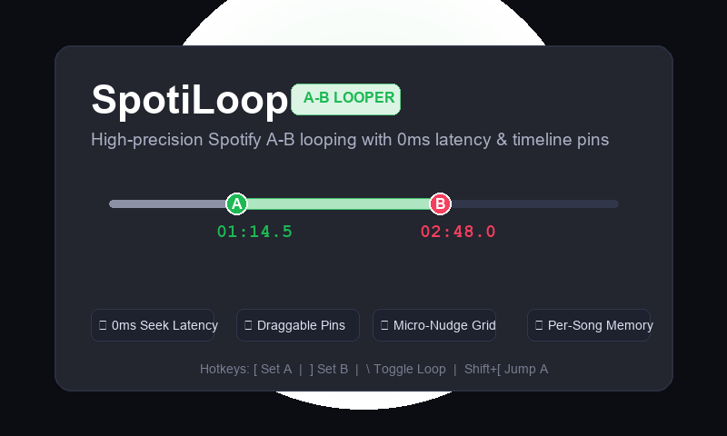

# SpotiLoop - High-Precision Spotify A-B Looper for Spicetify



A high-performance, native-feel A-B Looper extension for the Spotify Desktop client via **Spicetify**. Loop any section of any song with **0ms latency**, draggable timeline pins, micro-nudge adjustments, and automatic per-song memory.

---

## ✨ Features

- **⚡ 0ms Local Loop Engine**: Seeks are handled directly inside Spotify's internal desktop engine with zero network roundtrips, zero stutter, and no authentication keys required.
- **📍 Native Timeline Pins**:
  - **Point A Pin (Green)** and **Point B Pin (Red)** appear directly on Spotify's native playback progress bar.
  - **Highlighted Loop Region**: The area between Point A and Point B glows with an active accent.
  - **Interactive Dragging**: Click any pin to jump to it, or drag pins directly across the timeline while playback is running!
- **🎛️ Hybrid Controls**:
  - **Left-Click** bottom bar icon: Opens the **SpotiLoop Studio Flyout** with:
    - Master Loop ON/OFF switch
    - Digital time inputs supporting flexible formats (`1.47.`, `1.47`, `1:47`, raw seconds)
    - `🎯 Set Current Position` buttons
    - Micro-nudge grid (`-1.0s`, `+1.0s`, `-0.1s`, `+0.1s`)
    - Real-time loop counter badge (`🔁 5 loops`)
    - Quick jump buttons
  - **Right-Click** bottom bar icon: Opens a clean 1-click context menu (Set Point A, Set Point B, Jump, Toggle, Clear).
  - **Middle-Click / Alt+Click**: Instantly toggles loop ON / OFF.
- **💾 Automatic Per-Song Memory**: Loop boundaries are automatically saved per track URI in `localStorage`. Return to the track days later and your markers will immediately restore!
- **⌨️ Keyboard Shortcuts**:
  - `[` : Set Point A to current playback time
  - `]` : Set Point B to current playback time
  - `\` or `Alt + L` : Toggle loop ON / OFF
  - `Shift + [` : Jump to Point A
  - `Shift + ]` : Jump to Point B
  *(Automatically disabled when typing in search bars or text fields)*

---

## 🚀 Installation via Spicetify Marketplace

1. Open **Spotify**.
2. Click on the **Marketplace** icon in the sidebar or top bar.
3. Search for **SpotiLoop**.
4. Click **Install**.
5. Restart or reload Spotify (`Ctrl + Shift + R`).

---

## 🛠 Manual Installation

1. Copy `spotiloop.js` to your Spicetify Extensions directory:
   - **Windows**: `%appdata%\spicetify\Extensions\spotiloop.js`
   - **Linux/macOS**: `~/.config/spicetify/Extensions/spotiloop.js`

2. Enable the extension:
   ```bash
   spicetify config extensions spotiloop.js
   spicetify apply
   ```

---

## 👨‍💻 Author

Developed by **[DaivikOPX](https://github.com/DaivikOPX)**
Repository: [https://github.com/DaivikOPX/SpotiLoop](https://github.com/DaivikOPX/SpotiLoop)
